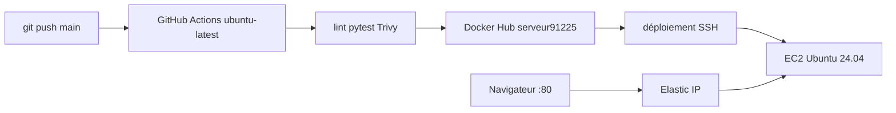
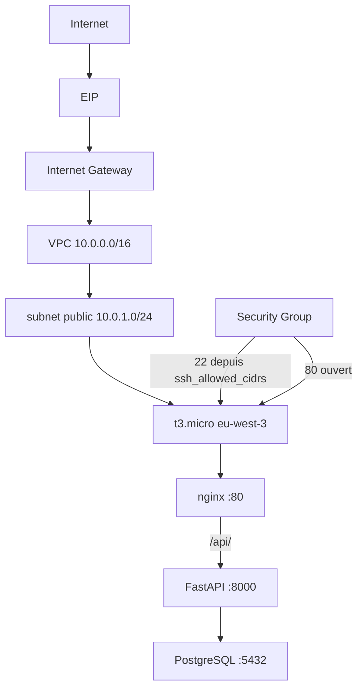

# Task Manager

Application de gestion de tâches : API FastAPI, PostgreSQL, interface
HTML/CSS/JavaScript natif. Infrastructure AWS par Terraform. CI/CD GitHub
Actions. Exécution par Docker Compose sur EC2.

## Architecture





Terraform crée le réseau et la VM. GitHub Actions teste, scanne, publie les
images, puis déploie par SSH et Docker Compose. Ansible n'est pas utilisé.
Le mot de passe PostgreSQL est généré sur l'EC2, pas dans GitHub.

### Structure

```
backend/        API, tests, Dockerfile
frontend/       HTML/CSS/JS, Dockerfile Nginx
nginx/          default.conf (HTTP)
terraform/      VPC, subnet, IGW, SG, EC2, EIP
scripts/        ec2-deploy.sh (exécuté sur la VM)
docker-compose.yml       développement local
docker-compose.prod.yml  production
.github/workflows/ci-cd.yml
```

## Local

```bash
docker compose up --build
cd backend && pip install -r requirements-dev.txt && python -m pytest -v
```

| Méthode | Route | Rôle |
|---|---|---|
| GET | `/api/health` | liveness |
| GET | `/api/ready` | base accessible |
| GET | `/api/tasks` | liste |
| POST | `/api/tasks` | création |
| DELETE | `/api/tasks/{id}` | suppression |

## Terraform

Région `eu-west-3`, `t3.micro`, Ubuntu 24.04, disque gp3 chiffré, IMDSv2.

```bash
cd terraform
cp terraform.tfvars.example terraform.tfvars
terraform init && terraform plan && terraform apply
terraform output security_group_id
```

`ssh_allowed_cidrs` est obligatoire, en `/32`. `0.0.0.0/0` sur le 22 est refusé.

Sur l'instance de test : Docker 29.1.3, Compose 2.40.3, swap 2 Gio (installés
manuellement).

## GitHub Actions

| Job | Runner | Rôle |
|---|---|---|
| Qualité du code | `ubuntu-24.04` | Ruff, Hadolint, Terraform validate |
| Tests backend | `ubuntu-24.04` | pytest + PostgreSQL |
| Analyse de sécurité | `ubuntu-24.04` | Trivy fs, bloque sur CRITICAL corrigeable |
| Images | `ubuntu-24.04` | build, Trivy image CRITICAL, push `main` |
| Déploiement | `ubuntu-latest` | SSH + Compose, sur `main` seulement |

Sur une Pull Request : tests et build, **aucune** publication, **aucun** SSH.

Sur `main` : publication

```
serveur91225/task-manager-backend:latest|<sha>
serveur91225/task-manager-frontend:latest|<sha>
```

puis déploiement SSH :

1. Copier `docker-compose.prod.yml`, `nginx/default.conf`, `scripts/ec2-deploy.sh`.
2. Créer `/opt/task-manager/.env` au premier run (mot de passe généré sur l'EC2, mode 0600).
3. `docker compose pull && up -d` avec `IMAGE_TAG=$GITHUB_SHA`.
4. `curl` HTTP `/healthz` et `/api/health`.

### Secrets (noms seulement)

| Type | Nom |
|---|---|
| Secret | `DOCKERHUB_USERNAME` (`serveur91225`, sert aussi de namespace d'images) |
| Secret | `DOCKERHUB_TOKEN` |
| Secret | `EC2_HOST` (`15.237.21.24`) |
| Secret | `EC2_USER` (`ubuntu`) |
| Secret | `EC2_SSH_KEY` |

Pas de secrets AWS ni PostgreSQL. `ubuntu` utilise `sudo docker` (AMI Ubuntu).

### SSH depuis GitHub Actions

Le Security Group n'autorise le port 22 que depuis `ssh_allowed_cidrs` (ton IP).
Les runners `ubuntu-latest` ont une IP Azure dynamique : **ils ne joignent pas
le SSH tant que le Security Group reste ainsi**. On n'ouvre pas `0.0.0.0/0`.
Le premier test se fait depuis ton PC, déjà autorisé.

## Rollback

Si le healthcheck local échoue, `ec2-deploy.sh` relance Compose avec le SHA
précédent enregistré dans `/opt/task-manager/.current_tag`. Le job GitHub
reste en échec. Pas de rollback automatique vers un SHA plus ancien au-delà
de cette dernière version. Un retour manuel :

```bash
export IMAGE_TAG=<sha-précédent>
sudo docker compose -f /opt/task-manager/docker-compose.prod.yml up -d --no-build
```

## Limitations

- **t3.micro (1 Gio RAM)** : la pile tient grâce à 2 Gio de swap. Pas de runner
  GitHub sur la VM.
- **SSH** : fermé à Internet par Terraform (ton IP uniquement). GitHub Actions
  n'atteint pas le port 22 tant que le Security Group reste inchangé. On n'ouvre
  pas `0.0.0.0/0`.
- **HTTPS / Let's Encrypt / Certbot** : non configurés dans cette démonstration.
  L'application est servie en HTTP sur le port 80 uniquement.
- Une instance, pas de sauvegarde Postgres, logs via `docker logs`.

## Nettoyage

```bash
cd terraform
terraform destroy
```

Supprime VPC, subnet, IGW, SG, key pair, EC2 et EIP. Conserver le
`terraform.tfstate` local jusqu'à cette commande. Les images Docker Hub restent.
