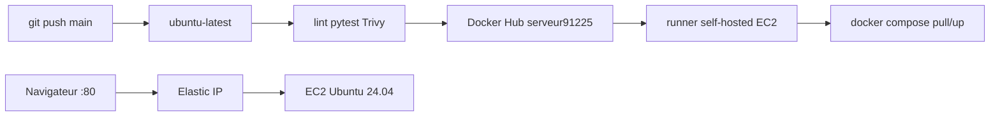
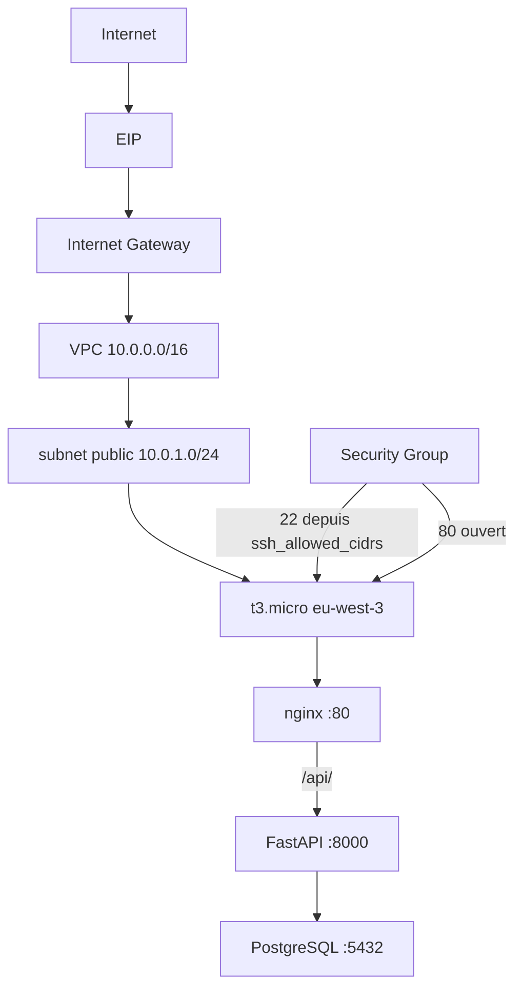

# Task Manager

Application de gestion de tâches : API FastAPI, PostgreSQL, interface
HTML/CSS/JavaScript natif. Infrastructure AWS par Terraform. CI/CD GitHub
Actions. Exécution par Docker Compose sur EC2.

## Architecture





Terraform crée le réseau et la VM. Les tests, Trivy et le build tournent sur
`ubuntu-latest`. Le job de déploiement tourne sur un runner self-hosted installé
sur l'EC2 : Docker Compose tire les images et redémarre les services, sans SSH
depuis GitHub et sans credentials AWS. Ansible n'est pas utilisé.
Le mot de passe PostgreSQL reste dans `/opt/task-manager/.env` (mode 0600).

### Structure

```
backend/        API, tests, Dockerfile
frontend/       HTML/CSS/JS, Dockerfile Nginx
nginx/          default.conf (HTTP)
terraform/      VPC, subnet, IGW, SG, EC2, EIP
scripts/        ec2-deploy.sh (exécuté sur la VM)
docker-compose.yml       développement local
docker-compose.prod.yml  production
.github/workflows/ci-cd.yml
```

## Local

```bash
docker compose up --build
cd backend && pip install -r requirements-dev.txt && python -m pytest -v
```

| Méthode | Route | Rôle |
|---|---|---|
| GET | `/api/health` | liveness |
| GET | `/api/ready` | base accessible |
| GET | `/api/tasks` | liste |
| POST | `/api/tasks` | création |
| DELETE | `/api/tasks/{id}` | suppression |

## Terraform

Région `eu-west-3`, `t3.micro`, Ubuntu 24.04, disque gp3 chiffré, IMDSv2.

```bash
cd terraform
cp terraform.tfvars.example terraform.tfvars
terraform init && terraform plan && terraform apply
terraform output security_group_id
```

`ssh_allowed_cidrs` est obligatoire, en `/32`. `0.0.0.0/0` sur le 22 est refusé.

Sur l'instance de test : Docker 29.1.3, Compose 2.40.3, swap 2 Gio (installés
manuellement).

## GitHub Actions

| Job | Runner | Rôle |
|---|---|---|
| Qualité du code | `ubuntu-24.04` | Ruff, Hadolint, Terraform validate |
| Tests backend | `ubuntu-24.04` | pytest + PostgreSQL |
| Analyse de sécurité | `ubuntu-24.04` | Trivy fs, bloque sur CRITICAL corrigeable |
| Images | `ubuntu-24.04` | build, Trivy image CRITICAL, push `main` |
| Déploiement | self-hosted `ec2-deploy` | Compose pull/up sur l'EC2, `main` seulement |

Sur une Pull Request : tests et build, **aucune** publication, **aucun**
déploiement (le runner EC2 n'exécute pas les PR).

Sur `main` : publication

```
serveur91225/task-manager-backend:latest|<sha>
serveur91225/task-manager-frontend:latest|<sha>
```

puis le runner self-hosted, déjà sur la VM :

1. Copier `docker-compose.prod.yml` et `nginx/default.conf` vers `/opt/task-manager`.
2. Réutiliser `/opt/task-manager/.env` existant (jamais recréé, jamais affiché).
3. `docker compose pull && up -d --no-build` avec `IMAGE_TAG=$GITHUB_SHA`.
4. Healthchecks locaux `/healthz`, `/api/health`, `/api/ready`.

Aucun build Docker ni pytest sur l'EC2 (1 Gio RAM).

### Secrets (noms seulement)

| Type | Nom | Usage |
|---|---|---|
| Secret | `DOCKERHUB_USERNAME` | namespace d'images + login pull |
| Secret | `DOCKERHUB_TOKEN` | login Docker Hub optionnel si l'image est privée |

Plus de secrets AWS, SSH ou PostgreSQL pour le déploiement.

### Runner self-hosted

Label `ec2-deploy`. Service systemd, utilisateur `ubuntu`, `sudo docker`
sans groupe `docker`. Enregistré **uniquement** sur ce dépôt, jamais sur une
organisation entière. SSH reste fermé à Internet (`ssh_allowed_cidrs` seulement).

Installation (sur l'EC2, depuis un SSH déjà autorisé) : GitHub → Settings →
Actions → Runners → New self-hosted runner, récupérer le jeton, puis :

```bash
sudo mkdir -p /home/ubuntu/actions-runner
sudo chown ubuntu:ubuntu /home/ubuntu/actions-runner
cd /home/ubuntu/actions-runner
curl -s https://api.github.com/repos/actions/runner/releases/latest \
  | grep -oP '"tag_name": "v\K[0-9.]+' | head -1 | tee /tmp/runner.ver
VER=$(cat /tmp/runner.ver)
curl -L -o actions-runner.tgz \
  "https://github.com/actions/runner/releases/download/v${VER}/actions-runner-linux-x64-${VER}.tar.gz"
tar xzf actions-runner.tgz
./config.sh --unattended \
  --url https://github.com/serveur9-1/TECH-DEVOPS \
  --token <JETON> \
  --name task-manager-ec2 \
  --labels ec2-deploy \
  --work _work
sudo ./svc.sh install ubuntu
sudo ./svc.sh start
```

Ne pas ajouter `ubuntu` au groupe `docker`. Le job deploy est le seul à
utiliser ce runner.

## Rollback

Si le healthcheck local échoue, `ec2-deploy.sh` relance Compose avec le SHA
précédent enregistré dans `/opt/task-manager/.current_tag`. Le job GitHub
reste en échec. Pas de rollback automatique vers un SHA plus ancien au-delà
de cette dernière version. Un retour manuel :

```bash
export IMAGE_TAG=<sha-précédent>
sudo docker compose -f /opt/task-manager/docker-compose.prod.yml up -d --no-build
```

## Limitations

- **t3.micro (1 Gio RAM)** : la pile tient grâce à 2 Gio de swap. Le runner
  self-hosted ne fait que `compose pull/up`, jamais de build ni de tests.
- **SSH** : fermé à Internet (ton IP uniquement). On n'ouvre pas `0.0.0.0/0`.
  Le déploiement n'utilise plus SSH depuis GitHub.
- **Runner self-hosted** : un workflow malveillant sur `main` aurait un accès
  local à la VM. D'où le filtre « `main` uniquement, pas de Pull Request ».
- **HTTPS / Let's Encrypt / Certbot** : non configurés dans cette démonstration.
  L'application est servie en HTTP sur le port 80 uniquement.
- Une instance, pas de sauvegarde Postgres, logs via `docker logs`.

## Nettoyage

```bash
cd terraform
terraform destroy
```

Supprime VPC, subnet, IGW, SG, key pair, EC2 et EIP. Conserver le
`terraform.tfstate` local jusqu'à cette commande. Les images Docker Hub restent.
